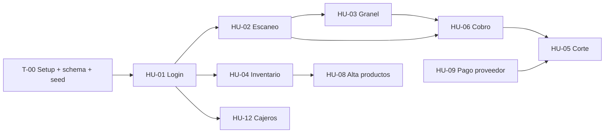

# 03 · Plan de entrega

## Sprint 3 (vigente): 2 al 15 de noviembre

**Meta:** que el administrador controle mermas, cubra la caja y vea el reporte semanal. **Compromiso:** 5 HU, 23 pts.

| Persona | Historias | Pts | Además |
|---|---|---|---|
| **Miguel** | HU-10 (3), HU-13 (13) | 16 | — |
| **Sosa** | HU-11 (2), HU-15 (3) | 5 | Scrum Master, revisión e integración de PRs, D-04 y D-05 |
| **Gonzalo** | HU-07 (2) | 2 | Disponibilidad limitada: solo esta historia |

### Por qué este reparto

- **Gonzalo** tiene una historia chica y sin dependencias, porque estará ausente la mayor parte del sprint.
- **Miguel** toma HU-10 y HU-13 juntas: el reporte incluye las mermas y así no depende de nadie.
- **Sosa** toma las dos que reutilizan lo que ya construyó (roles y cuentas) y conserva la coordinación, la revisión y la documentación.

### Dueños de módulo (Sprint 3)

| Módulo | Dueño |
|---|---|
| Merma en `modules/productos` + su pantalla en `features/inventario` | Miguel |
| `modules/reportes` + `features/reportes` (nuevos) | Miguel |
| `modules/proveedores` + `features/proveedores` (nuevos) | Gonzalo |
| `modules/usuarios` + `features/usuarios` | Sosa |

`Layout.tsx` y `App.tsx` son compartidos: cada quien agrega solo su renglón de menú y su ruta. **No se espera cambiar `schema.prisma`**; si hace falta, se pide a Sosa.

### Calendario

| Fecha | Sosa | Miguel | Gonzalo |
|---|---|---|---|
| **Mié 4 – Jue 5 nov** | HU-11 | HU-10 | HU-07, cuando pueda |
| **Vie 6 – Dom 8** | HU-15 | HU-10 en PR; empieza API de HU-13 | HU-07 |
| **Lun 9 – Mar 10** | Casos de uso y capturas (D-04) | API de HU-13 y tabla | **Fecha límite del PR: mar 10** |
| **Mié 11 – Jue 12** | Revisión | PDF de HU-13; PR | — |
| **Vie 13 – Sáb 14** | Integración y prueba completa | Correcciones de revisión | — |
| **Dom 15** | **Cierre:** review, retro, `develop → main`, tag `v0.3.0` | Revisar la demo | — |

### Puntos de control

- **Mar 10:** si no hay PR de HU-07, pasa a Sosa, para que no bloquee el cierre.
- **Mié 11:** si la API de HU-13 no está lista, Sosa toma el PDF (T-25).
- **Prioridad si falta tiempo:** primero HU-11, HU-15 y HU-10, que son las más chicas; HU-13 no se recorta, porque es lo que pide la meta del sprint.

## Sprint 1 + Sprint 2 (cerrado el 28 oct)

El Sprint 1 no se entregó. Para el cierre del Sprint 2 hay que entregar **las 9 HU de ambos sprints (47 pts)** más los **artefactos Scrum** que pide la maestra (ver `07-scrum-entregables.md`). Trabajando con IA es alcanzable si **nadie se bloquea con nadie**: por eso el reparto es por dominio y el modelo de datos se fija el primer día.

### Reparto

> **26 oct:** HU-08 se reasigna de Miguel a Sosa para tener alta de productos cuanto antes.
> **28 oct:** Gonzalo no puede continuar este sprint. Sus tareas se reparten: HU-02 y D-02 a Miguel; HU-09 y HU-05 a Sosa.

| Persona | Sprint 1 | Sprint 2 | Pts | Además (documentación) |
|---|---|---|---|---|
| **Sosa** | T-00 Setup, HU-01 (3), HU-06 (8) | HU-12 (5), HU-08 (5), HU-09 (3), HU-05 (8) | 32 | Documento Scrum, diagrama de clases/ER, burndown/burnup |
| **Gonzalo** | — | — | 0 | Sin tareas este sprint (baja temporal el 28 oct) |
| **Miguel** | HU-03 (8), HU-02 (5) | HU-04 (2) | 15 | Casos de uso; prototipos de pantallas y de alertas |

**Dueño de cada archivo/módulo** (para evitar conflictos de merge):

| Módulo | Dueño | Los demás… |
|---|---|---|
| `apps/api/prisma/schema.prisma`, seed, setup, auth, `usuarios` | Sosa | piden cambios al schema por PR pequeño o en el chat del equipo |
| `apps/api/src/modules/ventas` (confirmar venta + pagos) | Sosa | — |
| `apps/web/src/features/venta/carrito` (store del carrito, escaneo) + `VentaPage.tsx` | Miguel | Miguel agrega la captura de granel usando la API del store |
| `apps/api/src/modules/caja` + `apps/web/src/features/caja` (turnos, pagos a proveedor, corte) | Sosa | — |
| `apps/api/src/modules/productos` (lectura) + `apps/web/src/features/inventario/InventarioPage.tsx` | Miguel | El escaneo (HU-02) usa `GET /productos/codigo/:codigo` |
| Alta y entradas de productos: `crear`/`registrarEntrada` en `productos.service.ts` + `features/inventario/AgregarProductoPage.tsx` | Sosa (HU-08, hecha) | Miguel no necesita tocarlos |

### Dependencias

Para no esperar: T-00 deja **contratos** (rutas, tipos y store del carrito con funciones vacías) para que todos arranquen en paralelo con datos del seed.

### Calendario

> **Re-planeado el 26 oct:** Sosa terminó sus HU; las fechas vigentes de Gonzalo y Miguel están en `docs/00-empieza-aqui.md`. La tabla de abajo es el plan original.

| Día | Sosa | Gonzalo | Miguel |
|---|---|---|---|
| **Mié 21 – Jue 22 oct** | **T-00**: monorepo, Docker Postgres, schema completo, seed, login base, layout | Prototipos de pantallas (venta, cobro, caja, alertas) | Diagrama de casos de uso + descripciones |
| **Vie 23 – Sáb 24** | HU-01 completa (roles, guard, logout) | HU-02 escaneo + carrito | HU-03 granel (sobre el store del carrito) |
| **Dom 25 – Lun 26** | HU-06 cobro mixto + cambio + descuento de stock | HU-09 pagos a proveedor + abrir caja | HU-04 consulta de inventario |
| **Mar 27 – Mié 28** | HU-12 cuentas de cajero | HU-05 corte y cierre | HU-08 alta de productos + movimientos |
| **Jue 29 – Vie 30** | Integración, diagrama de clases, burndown | Pruebas end-to-end del turno completo | Pruebas de inventario, capturas para el doc |
| **Sáb 31 oct** | Documento Scrum completo, review de demo | Ensayo de demo | Ensayo de demo |
| **Dom 1 nov** | **ENTREGA** — tag `v0.2.0`, documento en Drive | | |

Daily scrum **todos los días** (asíncrono vale: cada quien corre `/daily` y sube su parte) → `docs/scrum/dailies/`.

### Definición de "Hecho" (DoD)

Una HU está hecha cuando:
1. Cumple **todos** sus criterios de aceptación (`02-backlog.md`).
2. Tiene pruebas de API (Vitest + supertest) para los CA con lógica (cálculos, permisos, validaciones).
3. `npm run lint` y `npm test` pasan.
4. Se mergeó a `develop` por **PR aprobado e integrado por Sosa** (los PRs de Sosa se integran directo).
5. Su tarjeta está en *Hecho* en el tablero, con el issue cerrado, y se puede demostrar con datos del seed.

### Plan de contingencia

Si el jueves 29 algo no está, se recorta en este orden (de lo menos a lo más importante): HU-08 sumar existencias → HU-12 restablecer contraseña → búsqueda manual de HU-02. **Nunca** se recorta el flujo login → venta → cobro → corte: es la demo.
