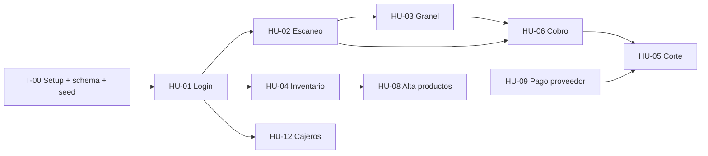

# 03 · Plan de entrega: Sprint 1 + Sprint 2 → domingo 1 de noviembre

El Sprint 1 no se entregó. Para el cierre del Sprint 2 hay que entregar **las 9 HU de ambos sprints (47 pts)** más los **artefactos Scrum** que pide la maestra (ver `07-scrum-entregables.md`). Trabajando con IA es alcanzable si **nadie se bloquea con nadie**: por eso el reparto es por dominio y el modelo de datos se fija el primer día.

## Reparto (≈ 16 pts por persona)

| Persona | Sprint 1 | Sprint 2 | Pts | Además (documentación) |
|---|---|---|---|---|
| **Sosa** | T-00 Setup, HU-01 (3), HU-06 (8) | HU-12 (5) | 16 | Documento Scrum, diagrama de clases/ER, burndown/burnup |
| **Gonzalo** | HU-02 (5) | HU-09 (3), HU-05 (8) | 16 | Prototipos de pantallas y de alertas |
| **Miguel** | HU-03 (8) | HU-04 (2), HU-08 (5) | 15 | Diagrama y descripciones de casos de uso |

**Dueño de cada archivo/módulo** (para evitar conflictos de merge):

| Módulo | Dueño | Los demás… |
|---|---|---|
| `apps/api/prisma/schema.prisma`, seed, setup, auth, `usuarios` | Sosa | piden cambios al schema por PR pequeño o en el chat del equipo |
| `apps/api/src/modules/ventas` (confirmar venta + pagos) | Sosa | — |
| `apps/web/src/features/venta/carrito` (store del carrito, escaneo) | Gonzalo | Miguel agrega la captura de granel usando la API del store |
| `apps/api/src/modules/caja` (turnos, pagos a proveedor, corte) | Gonzalo | Sosa usa `turnoAbierto()` al confirmar venta |
| `apps/api/src/modules/productos` + `apps/web/src/features/inventario` | Miguel | Gonzalo usa `GET /productos/codigo/:codigo` |

## Dependencias

Para no esperar: T-00 deja **contratos** (rutas, tipos y store del carrito con funciones vacías) para que todos arranquen en paralelo con datos del seed.

## Calendario

| Día | Sosa | Gonzalo | Miguel |
|---|---|---|---|
| **Mié 21 – Jue 22 oct** | **T-00**: monorepo, Docker Postgres, schema completo, seed, login base, layout | Prototipos de pantallas (venta, cobro, caja, alertas) | Diagrama de casos de uso + descripciones |
| **Vie 23 – Sáb 24** | HU-01 completa (roles, guard, logout) | HU-02 escaneo + carrito | HU-03 granel (sobre el store del carrito) |
| **Dom 25 – Lun 26** | HU-06 cobro mixto + cambio + descuento de stock | HU-09 pagos a proveedor + abrir caja | HU-04 consulta de inventario |
| **Mar 27 – Mié 28** | HU-12 cuentas de cajero | HU-05 corte y cierre | HU-08 alta de productos + movimientos |
| **Jue 29 – Vie 30** | Integración, diagrama de clases, burndown | Pruebas end-to-end del turno completo | Pruebas de inventario, capturas para el doc |
| **Sáb 31 oct** | Documento Scrum completo, review de demo | Ensayo de demo | Ensayo de demo |
| **Dom 1 nov** | **ENTREGA** — tag `v0.2.0`, documento en Drive | | |

Daily scrum **todos los días** (asíncrono vale: cada quien corre `/daily` y sube su parte) → `docs/scrum/dailies/`.

## Definición de "Hecho" (DoD)

Una HU está hecha cuando:
1. Cumple **todos** sus criterios de aceptación (`02-backlog.md`).
2. Tiene pruebas de API (Vitest + supertest) para los CA con lógica (cálculos, permisos, validaciones).
3. `npm run lint` y `npm test` pasan.
4. Se mergeó a `develop` por **PR revisado por otro integrante**.
5. Se marcó en `docs/scrum/sprint-backlog.md` y se puede demostrar con datos del seed.

## Plan de contingencia

Si el jueves 29 algo no está, se recorta en este orden (de lo menos a lo más importante): HU-08 sumar existencias → HU-12 restablecer contraseña → búsqueda manual de HU-02. **Nunca** se recorta el flujo login → venta → cobro → corte: es la demo.
