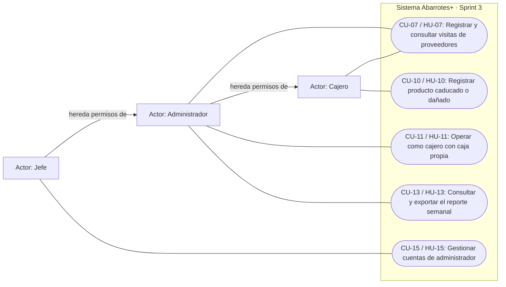
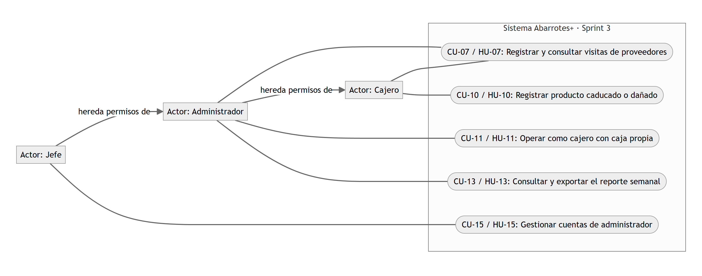

# Casos de uso · Sprint 3

**Responsable documental:** Luis David Sosa Fernández (D-04). **Fecha:** 9 de noviembre de 2026.

Este documento cubre las cinco historias del Sprint 3 (2 al 15 de noviembre). Continúa a [casos-de-uso.md](casos-de-uso.md), que describe el Sprint 1 y el Sprint 2. Describe el comportamiento acordado en el [backlog](../02-backlog.md); el estado de cada tarea se consulta en el [tablero](https://github.com/users/notNorthStar/projects/1/views/2).

**Estado al 9 de noviembre:** HU-10, HU-11, HU-13 y HU-15 están integradas en `develop` (PRs #50, #53, #51 y #54). HU-07 está en desarrollo; su PR vence el 10 de noviembre, así que su descripción todavía no tiene captura.

## Diagrama

Igual que en el Sprint 1 y el Sprint 2, Mermaid representa los actores y sus asociaciones con un diagrama de flujo. La generalización de roles refleja la jerarquía de permisos: el administrador hereda los casos de uso del cajero, y el jefe los del administrador.

En CU-07, el cajero consulta las visitas y el administrador además las registra. CU-11 no agrega funciones nuevas: comprueba que el administrador usa los casos de uso del cajero (CU-02 a CU-09) con su propia caja. El reporte de CU-13 incluye las mermas que registra CU-10.

## Pantallas y evidencia visual

Las capturas son de la aplicación real con datos de ejemplo, tomadas el 9 de noviembre de 2026 a 1440×900. El [catálogo de prototipos](../prototipos/README.md) explica cómo reproducirlas.

| Referencia | Ruta de la aplicación | Pantalla fuente | Capturas |
|---|---|---|---|
| P-08 | `/mermas` | [Registrar merma](../../apps/web/src/features/inventario/MermaPage.tsx) | [Registro](../prototipos/img/merma.png) · [Existencia insuficiente](../prototipos/img/alerta-merma-sin-existencia.png) |
| P-09 | `/reportes` | [Reporte semanal](../../apps/web/src/features/reportes/ReportesPage.tsx) | [Reporte de la semana](../prototipos/img/reporte.png) |
| P-10 | `/administradores` | [Administradores](../../apps/web/src/features/usuarios/AdministradoresPage.tsx) | [Cuentas de administrador](../prototipos/img/administradores.png) |
| P-02, P-03, P-05 | `/venta`, `/caja` | Las del Sprint 2 | Las usa el administrador en CU-11 |
| P-11 | Pendiente | HU-07 | Se agrega cuando se integre |

## CU-07 · Registrar y consultar visitas de proveedores

**Historia / responsable de implementación:** HU-07 · Gonzalo. **Estado:** en desarrollo. **Actores:** cajero (consulta) y administrador (registra y consulta). **Pantalla:** P-11, pendiente.

**Objetivo:** que el cajero sepa qué día viene cada proveedor, para revisar el inventario con anticipación.

**Precondiciones:** sesión válida. Para registrar se necesita rol mínimo administrador.

**Flujo principal:**
1. El administrador captura el proveedor, la fecha de la visita y una nota opcional.
2. El sistema guarda la visita en la sucursal del administrador.
3. El cajero abre la lista de visitas, ordenada por fecha y proveedor.

**Alternos:** un cajero no puede registrar visitas. Cada usuario ve solo las visitas de su sucursal. No hay calendario visual.

**Postcondiciones:** la visita queda disponible para los usuarios de la sucursal. **Trazabilidad:** CA1–CA3.

## CU-10 · Registrar producto caducado o dañado

**Historia / responsable de implementación:** HU-10 · Miguel (PR #50). **Actor principal:** cajero; administrador y jefe por jerarquía de permisos. **Pantalla:** P-08.

**Objetivo:** sacar del inventario un producto que ya no se puede vender, sin que afecte el cierre de caja.

**Precondiciones:** sesión válida y producto activo de la sucursal. No se necesita caja abierta ni autorización del administrador.

**Flujo principal:**
1. El cajero abre Registrar merma y busca el producto por nombre o código.
2. Elige el producto; el sistema muestra su existencia.
3. Captura la cantidad, el motivo (caducado o dañado) y un comentario opcional.
4. En una sola transacción, el sistema descuenta la existencia y registra un movimiento `MERMA` con usuario y fecha.
5. Muestra la existencia actualizada.

**Alternos:** si la cantidad supera la existencia, el sistema la rechaza («La cantidad supera la existencia disponible») sin modificar el inventario (decisión del PO del 9 de noviembre). Por pieza solo se aceptan enteros y por kilo hasta tres decimales. Si dos personas registran mermas al mismo tiempo, no pueden dejar la existencia negativa.

**Postcondiciones:** la existencia disminuye y el efectivo esperado del corte no cambia. La merma aparece en el reporte de CU-13. **Trazabilidad:** CA1–CA6.

## CU-11 · Operar como cajero con caja propia

**Historia / responsable de implementación:** HU-11 · Sosa (PR #53). **Actor principal:** administrador. **Pantallas:** P-02, P-03 y P-05 del Sprint 2.

**Objetivo:** que el administrador atienda la tienda los días en que no hay cajero.

**Precondiciones:** sesión de administrador. Para vender o pagar a un proveedor debe tener su propia caja abierta.

**Flujo principal:**
1. El administrador abre su caja con un monto inicial (CU-05).
2. Vende y cobra (CU-02, CU-03, CU-06), registra pagos a proveedor (CU-09), consulta el inventario (CU-04) y agrega productos (CU-08).
3. Solicita su corte: solo incluye sus propias ventas y pagos.
4. Cierra su caja.

**Alternos:** no puede abrir una segunda caja mientras tenga una abierta. Un cajero de la misma sucursal puede tener su caja abierta al mismo tiempo; cerrar una no cierra la otra.

**Postcondiciones:** el corte queda por persona y no se mezcla con el de los cajeros. **Trazabilidad:** CA1–CA3.

## CU-13 · Consultar y exportar el reporte semanal

**Historia / responsable de implementación:** HU-13 · Miguel (PR #51). **Actor principal:** administrador; el jefe indica la sucursal. **Pantalla:** P-09.

**Objetivo:** conocer los ingresos, los pagos, el producto agregado y las mermas de la semana, con quién hizo cada operación.

**Precondiciones:** sesión con rol mínimo administrador.

**Flujo principal:**
1. El administrador abre Reporte semanal y elige cualquier día; el sistema toma la semana de lunes a domingo, en horario de Ciudad de México.
2. Muestra los ingresos por forma de pago, con el efectivo neto de cambio.
3. Muestra en tablas las ventas, los pagos a proveedor, los productos agregados y las mermas, cada uno con su responsable y fecha.
4. El administrador exporta el mismo reporte a PDF.

**Alternos:** una semana sin operaciones muestra ceros y tablas vacías, y también se puede exportar. El administrador no puede ver otra sucursal alterando la consulta. Un cajero no tiene acceso. No incluye gráficas.

**Postcondiciones:** solo se consultan datos; la tabla y el PDF salen de la misma consulta, así que muestran las mismas cifras. **Trazabilidad:** CA1–CA5.

## CU-15 · Gestionar cuentas de administrador

**Historia / responsable de implementación:** HU-15 · Sosa (PR #54). **Actor principal:** jefe. **Pantalla:** P-10.

**Objetivo:** administrar el acceso de los administradores de cada sucursal, conservando su historial.

**Precondiciones:** sesión de jefe y sucursal activa.

**Flujo principal:**
1. El jefe abre Administradores y elige la sucursal.
2. Consulta las cuentas de administrador de esa sucursal.
3. Captura nombre, usuario y contraseña para crear una cuenta, que queda ligada a la sucursal elegida.

**Alternos:** el jefe puede suspender una cuenta (ya no inicia sesión), reactivarla, restablecer su contraseña o eliminarla de forma lógica con estado `ELIMINADO`. Un administrador o un cajero no pueden acceder a estas operaciones. Un usuario duplicado o una sucursal inexistente se rechazan.

**Postcondiciones:** la cuenta refleja la operación; al eliminarla se conservan sus turnos y operaciones. Reutiliza la gestión de cuentas de CU-12. **Trazabilidad:** CA1–CA4.

## Pendiente

1. Agregar la captura de HU-07 (P-11) cuando se integre su PR, y quitar la marca "en desarrollo" de CU-07.
2. Volver a exportar `img/casos-de-uso-sprint-3.png` si cambia el diagrama.
