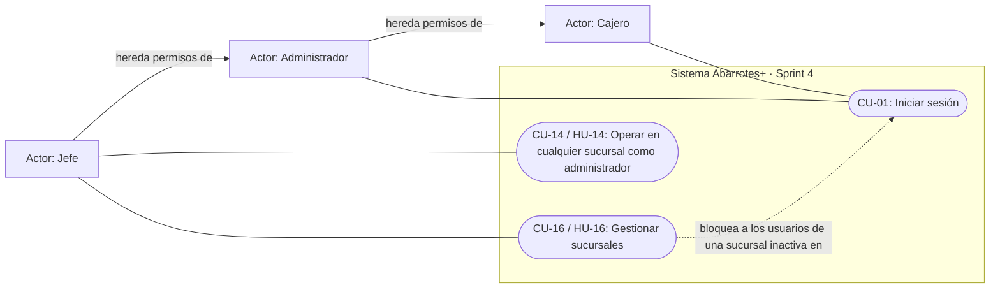
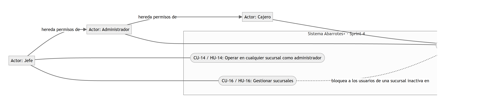

# Casos de uso · Sprint 4

**Responsable documental:** Luis David Sosa Fernández (D-06, reasignada de Gonzalo el 26 de noviembre de 2026). **Fecha:** 26 de noviembre de 2026.

Este documento cubre las dos historias del Sprint 4 (16 al 29 de noviembre). Continúa a [casos-de-uso.md](casos-de-uso.md) (Sprint 1 y Sprint 2) y a [casos-de-uso-sprint-3.md](casos-de-uso-sprint-3.md). Describe el comportamiento acordado en el [backlog](../02-backlog.md); el estado de cada tarea se consulta en el [tablero](https://github.com/users/notNorthStar/projects/1/views/5).

**Estado al 26 de noviembre:** las dos historias están integradas en `develop`: HU-14 (#70) y HU-16 (#87).

## Diagrama

Igual que en los sprints anteriores, Mermaid representa los actores y sus asociaciones con un diagrama de flujo. Las dos historias del Sprint 4 son del jefe; el cajero y el administrador aparecen porque CU-16 los afecta al suspender su sucursal.

CU-14 no agrega funciones nuevas: permite que el jefe use todos los casos de uso del administrador (CU-02 a CU-13) sobre la sucursal que elija. CU-16 cambia el resultado de CU-01 para los usuarios de una sucursal suspendida o eliminada.

## Pantallas y evidencia visual

Las capturas son de la aplicación real con datos locales de ejemplo, tomadas el 26 de noviembre de 2026 a 1440×900 (las de teléfono a 390×844). El [catálogo de prototipos](../prototipos/README.md) explica cómo reproducirlas.

| Referencia | Ruta de la aplicación | Pantalla fuente | Capturas |
|---|---|---|---|
| P-12 | Barra superior, en cualquier ruta | [Layout](../../apps/web/src/components/Layout.tsx) | [Inventario de Centro](../prototipos/img/jefe-inventario-centro.png) · [Venta en Norte](../prototipos/img/jefe-venta-norte.png) |
| P-13 | `/sucursales` | [Sucursales](../../apps/web/src/features/sucursales/SucursalesPage.tsx) | [Lista y alta](../prototipos/img/sucursales.png) · [Confirmar suspensión](../prototipos/img/sucursales-confirmar-suspender.png) |
| A-06 / P-01 | `/login` | [Acceso](../../apps/web/src/pages/Login.tsx) | [Usuario de sucursal suspendida](../prototipos/img/alerta-sucursal-suspendida.png) |

## CU-14 · Operar en cualquier sucursal como administrador

**Historia / responsable de implementación:** HU-14 · Sosa (PR #70). **Actor principal:** jefe. **Pantalla:** P-12 y todas las del administrador.

**Objetivo:** que el jefe atienda cualquier sucursal cuando falle su administrador.

**Precondiciones:** sesión de jefe y al menos una sucursal activa.

**Flujo principal:**
1. El jefe inicia sesión; la barra superior muestra el selector con las sucursales activas.
2. Elige una sucursal. El sistema la recuerda al navegar y al recargar.
3. Opera como administrador: cajeros, productos, inventario, mermas, visitas de proveedores, reporte semanal y caja. Cada petición lleva `?sucursalId=` de la sucursal elegida.
4. Cambia de sucursal en el selector; las pantallas se recargan con los datos de la nueva.

**Alternos:** si la sucursal guardada ya no está activa, el selector toma la primera activa. El servidor rechaza una sucursal que no existe (404). El administrador y el cajero no ven el selector y siguen operando solo en su sucursal, aunque alteren la consulta.

**Postcondiciones:** las operaciones quedan registradas en la sucursal elegida, con el jefe como responsable. **Trazabilidad:** CA1–CA5.

## CU-16 · Gestionar sucursales

**Historia / responsable de implementación:** HU-16 · Miguel (PR #87). **Actor principal:** jefe. **Pantalla:** P-13.

**Objetivo:** llevar el control de las sucursales activas e inactivas del negocio.

**Precondiciones:** sesión de jefe.

**Flujo principal:**
1. El jefe abre Sucursales y ve la lista con el estado de cada una.
2. Para crear una, captura el nombre (obligatorio) y la dirección (opcional). La sucursal se crea activa y aparece en el selector de CU-14.
3. Para suspender una, confirma la acción. Sus usuarios ya no pueden iniciar sesión y sus sesiones abiertas se cortan en la siguiente petición.
4. Puede reactivarla; sus usuarios vuelven a entrar.

**Alternos:** eliminar es lógico (`estado = ELIMINADO`): la sucursal desaparece de la lista y del selector y sus usuarios ya no entran. Se puede suspender o eliminar con cajas abiertas, que se conservan tal como están (decisión del PO del 25 de noviembre). Un administrador o un cajero no tienen acceso. Un usuario de una sucursal suspendida que intenta entrar ve «Tu sucursal no está activa. Contacta al jefe.» (A-06).

**Postcondiciones:** el inventario, las ventas, los turnos y los movimientos de la sucursal se conservan. No cambia el modelo de datos. **Trazabilidad:** CA1–CA5.

## Ajuste del 26 de noviembre (T-37)

Al comparar el backlog con lo entregado se cerraron dos huecos (PR #90):

- **CU-05 · Cerrar caja (HU-05 CA5):** el comentario ahora se exige en todo cierre, no solo cuando hay diferencia.
- **CU-12 y CU-15 · Suspender cuentas:** igual que en CU-16, la sesión abierta de una cuenta suspendida o eliminada se corta en su siguiente petición y la aplicación vuelve al acceso.

## Mantenimiento

Si cambia el diagrama, volver a exportar `img/casos-de-uso-sprint-4.png`.
