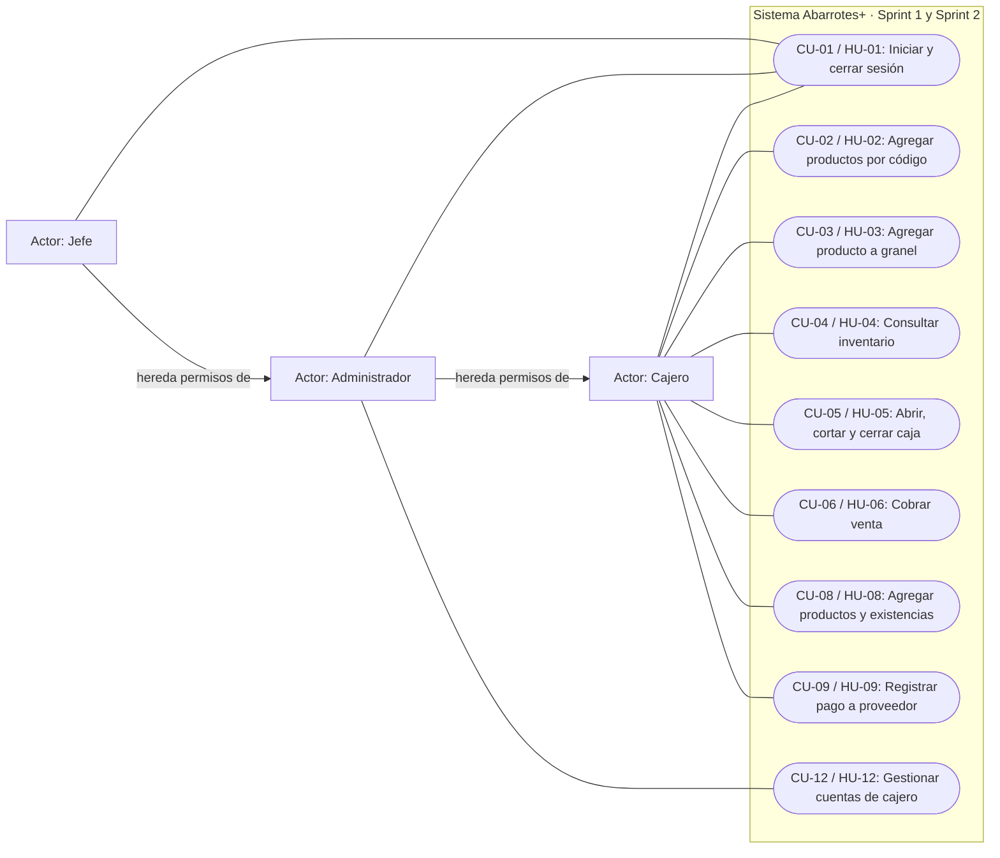

# Casos de uso · Sprint 1 + Sprint 2

**Responsable documental:** Miguel Angel Marcelo Taracena. **Fecha:** 27 de octubre de 2026.

Este documento cubre las nueve historias comprometidas para la entrega del 1 de noviembre. Describe el comportamiento acordado en el [backlog](../02-backlog.md); no certifica que las nueve historias estén implementadas o aprobadas. El estado de cada tarea se consulta en el [sprint backlog](../scrum/sprint-backlog.md).

## Diagrama

Mermaid representa los actores y sus asociaciones mediante un diagrama de flujo. Los óvalos son casos de uso dentro del límite del sistema. La generalización de roles refleja la jerarquía de permisos del proyecto; no añade funcionalidades de sprints posteriores.

Las asociaciones no representan el orden de ejecución. Para cobrar o pagar a un proveedor debe existir un turno abierto. La captura de productos por código o por peso prepara el mismo carrito; las existencias se descuentan al confirmar el cobro, no al capturar el carrito. El alcance de sucursal se valida en el servidor. El selector general de sucursal de HU-14 queda fuera de estos sprints.

## Pantallas y evidencia visual

La tabla vincula cada descripción con su pantalla fuente y con la evidencia visual de D-02, reasignada a Miguel el 28 de octubre. El [catálogo de prototipos](../prototipos/README.md) describe las pantallas, alertas y pasos para reproducirlas. Las once capturas enlazadas están incluidas y verificadas con datos locales el 28 de octubre de 2026.

| Referencia | Ruta de la aplicación | Pantalla fuente | Capturas de D-02 |
|---|---|---|---|
| P-01 | `/login` | [Login](../../apps/web/src/pages/Login.tsx) | [Acceso](../prototipos/img/login.png) · [Cuenta suspendida](../prototipos/img/alerta-usuario-suspendido.png) |
| P-02 | `/venta` | [Venta](../../apps/web/src/features/venta/VentaPage.tsx) | [Escaneo, búsqueda y carrito](../prototipos/img/venta.png) · [Producto no encontrado](../prototipos/img/alerta-producto-no-encontrado.png) |
| P-03 | `/venta` | [Cobro](../../apps/web/src/features/venta/cobro/Cobro.tsx) | [Métodos, referencia y cambio](../prototipos/img/cobro.png) · [Pago insuficiente](../prototipos/img/alerta-pago-insuficiente.png) |
| P-04 | `/inventario` | [Inventario](../../apps/web/src/features/inventario/InventarioPage.tsx) | [Consulta de inventario](../prototipos/img/inventario.png) |
| P-05 | `/caja` | [Caja](../../apps/web/src/features/caja/CajaPage.tsx) | [Corte y operación de caja](../prototipos/img/caja.png) · [Diferencia en cierre](../prototipos/img/alerta-diferencia-corte.png) |
| P-06 | `/productos/nuevo` | [Agregar productos](../../apps/web/src/features/inventario/AgregarProductoPage.tsx) | [Alta y entrada de existencias](../prototipos/img/productos.png) |
| P-07 | `/usuarios` | [Cajeros](../../apps/web/src/features/usuarios/UsuariosPage.tsx) | [Gestión de cuentas de cajero](../prototipos/img/cajeros.png) |

## CU-01 · Iniciar y cerrar sesión

**Historia / responsable de implementación:** HU-01 · Sosa. **Actores:** cajero, administrador y jefe. **Pantalla:** P-01; cierre desde el botón Salir del [encabezado](../../apps/web/src/components/Layout.tsx).

**Objetivo:** acceder a las funciones autorizadas y terminar la sesión.

**Precondiciones:** existe una cuenta con usuario y contraseña; para acceder, la cuenta y su sucursal deben permitir el inicio de sesión.

**Flujo principal:**
1. El usuario abre el acceso y captura usuario y contraseña.
2. El sistema verifica las credenciales contra la contraseña almacenada con hash bcrypt y valida el estado de cuenta y sucursal.
3. Inicia la sesión y redirige al cajero a venta y al administrador/jefe a su panel.
4. Cuando el usuario selecciona Salir, termina la sesión.

**Alternos:** credenciales incorrectas muestran «Usuario o contraseña incorrectos»; una cuenta suspendida/eliminada o una sucursal suspendida impide entrar. No se contempla recuperación por correo ni bloqueo por intentos.

**Postcondiciones:** la sesión permite únicamente las funciones del rol; después de salir se requiere autenticarse de nuevo. **Trazabilidad:** CA1–CA5.

## CU-02 · Agregar productos por código de barras

**Historia / responsable de implementación:** HU-02 · Miguel (reasignada de Gonzalo el 28 oct). **Actor principal:** cajero. **Pantalla:** P-02.

**Objetivo:** preparar la cuenta del cliente con productos identificados por código.

**Precondiciones:** sesión válida, productos registrados en la sucursal y pantalla de venta abierta. El lector USB funciona como teclado y envía Enter.

**Flujo principal:**
1. El cajero escanea el código en el campo enfocado.
2. El sistema encuentra el producto y lo añade al carrito; si ya existe, suma la cantidad.
3. Muestra subtotal por renglón y total actualizado.
4. El cajero puede ajustar cantidades o quitar un renglón antes de cobrar.
5. El campo de escaneo recupera el foco después de las acciones.

**Alternos:** un código no encontrado muestra aviso y ofrece búsqueda manual por nombre. Si el producto es por kilo se utiliza CU-03 para capturar su peso. Las piezas aceptan cantidades enteras.

**Postcondiciones:** el carrito queda preparado para CU-06; todavía no se guarda la venta ni se descuenta inventario. **Trazabilidad:** CA1–CA5 y nota sobre foco.

## CU-03 · Agregar producto a granel

**Historia / responsable de implementación:** HU-03 · Miguel. **Actor principal:** cajero. **Pantalla:** P-02.

**Objetivo:** añadir un producto por peso con cálculo automático de su importe.

**Precondiciones:** sesión válida, producto de la sucursal con unidad `KILO` y precio por kilogramo registrado.

**Flujo principal:**
1. El cajero selecciona un producto por kilo y se abre la captura manual de peso.
2. Elige kilogramos o gramos e introduce un valor positivo.
3. Si capturó gramos, el sistema divide entre 1000 para obtener kilogramos; la cantidad en kg admite hasta tres decimales.
4. Calcula el subtotal como peso en kg multiplicado por precio/kg, con redondeo half-up a dos decimales.
5. El cajero confirma y el producto se integra al mismo carrito de CU-02.
6. El renglón muestra el peso, precio/kg y subtotal; se actualiza el total.

**Alternos:** peso cero, negativo, no numérico o con precisión no permitida impide agregar y muestra el error. Para unidad `PIEZA` solo se permiten cantidades enteras. Cancelar la captura conserva el carrito sin esa incorporación. No existe integración con báscula.

**Postcondiciones:** el carrito contiene una cantidad válida y un importe calculado con precisión decimal. Al cobrar, el servidor vuelve a calcular precios e importes. **Trazabilidad:** CA1–CA6.

## CU-04 · Consultar inventario

**Historia / responsable de implementación:** HU-04 · Miguel. **Actor principal:** cajero. **Pantalla:** P-04.

**Objetivo:** conocer precio, existencia y unidad de los productos de la sucursal.

**Precondiciones:** sesión válida y sucursal del usuario identificada por el servidor.

**Flujo principal:**
1. El cajero abre Inventario.
2. El sistema consulta los productos de su sucursal y muestra precio, existencia y unidad.
3. El cajero escribe nombre o código y solicita la búsqueda.
4. El sistema muestra las coincidencias limitadas a la misma sucursal.

**Alternos:** sin coincidencias se informa que no hay resultados; una falla de conexión se informa para permitir volver a consultar. El usuario no puede consultar otra sucursal alterando parámetros de la petición.

**Postcondiciones:** se muestran datos de consulta y no se modifica inventario. El alta y las entradas corresponden a CU-08. **Trazabilidad:** CA1–CA3.

## CU-05 · Abrir, consultar corte y cerrar caja

**Historia / responsable de implementación:** HU-05 · Sosa (reasignada de Gonzalo el 28 oct). **Actor principal:** cajero. **Pantalla:** P-05.

**Objetivo:** registrar la apertura y comparar el efectivo esperado con el contado al cierre.

**Precondiciones:** sesión válida; para abrir no debe existir otro turno abierto del mismo cajero. Para consultar corte o cerrar debe existir su turno abierto.

**Flujo principal:**
1. El cajero captura el monto inicial y abre su caja.
2. Durante el turno registra ventas y pagos a proveedores.
3. Solicita el corte; el sistema muestra totales separados por efectivo, tarjeta y transferencia.
4. Calcula efectivo esperado = monto inicial + ventas en efectivo netas de cambio − pagos a proveedor en efectivo.
5. El cajero captura efectivo contado y comentario de cierre según la regla acordada.
6. El sistema muestra diferencia = contado − esperado y registra el cierre.

**Alternos:** sin caja abierta se impide vender y pagar a proveedores; un segundo turno abierto se rechaza. La diferencia positiva indica sobrante y la negativa faltante. **Duda del backlog sin resolver:** CA5 exige comentario al cerrar, pero su interpretación propone exigirlo solo si la diferencia es distinta de cero; debe confirmarse con el PO antes de dar este criterio por cerrado. El reporte detallado corresponde a HU-13.

**Postcondiciones:** el turno conserva montos y diferencia, y queda cerrado para nuevas operaciones. **Trazabilidad:** CA1–CA5.

## CU-06 · Cobrar venta

**Historia / responsable de implementación:** HU-06 · Sosa. **Actor principal:** cajero. **Pantalla:** P-03.

**Objetivo:** guardar una venta y sus pagos, calcular cambio y descontar existencias.

**Precondiciones:** sesión válida, turno abierto y carrito con productos de la sucursal y cantidades válidas.

**Flujo principal:**
1. El cajero revisa el total y selecciona efectivo, tarjeta, transferencia o una combinación.
2. Captura montos y, para tarjeta/transferencia, el número de referencia.
3. El servidor recupera los precios y recalcula subtotales y total.
4. Verifica que los pagos cubran el total y que tarjeta/transferencia no excedan el saldo.
5. Si hay efectivo recibido por encima del saldo pendiente, calcula el cambio.
6. Confirma en una transacción la venta, sus renglones, pagos y descuento de existencia.

**Alternos:** pago insuficiente o exceso no permitido de tarjeta/transferencia impide confirmar; las validaciones de productos, cantidades y turno pueden rechazar la operación sin una venta parcialmente guardada. Tarjeta y transferencia solo se registran: no hay comunicación bancaria.

**Postcondiciones:** la venta y sus pagos quedan registrados y el inventario disminuye; los pagos en efectivo netos de cambio alimentan CU-05. **Trazabilidad:** CA1–CA6.

## CU-08 · Agregar productos y existencias

**Historia / responsable de implementación:** HU-08 · Sosa, reasignada de Miguel el 26 de octubre. **Actor principal:** cajero; administrador y jefe también tienen permiso según el backlog. **Pantalla:** P-06.

**Objetivo:** registrar productos nuevos o recibir existencias sin esperar aprobación administrativa.

**Precondiciones:** sesión válida y sucursal de destino autorizada por el servidor.

**Flujo principal:**
1. El cajero elige dar de alta un producto.
2. Captura código de barras, nombre, precio, unidad pieza/kilo y cantidad inicial.
3. El sistema verifica que el código sea único dentro de la sucursal y valida los datos.
4. Guarda el producto y su movimiento de inventario con usuario y fecha.

**Alterno de entrada:** busca un producto existente por código, captura la cantidad que ingresa y confirma; el sistema suma la existencia y registra el movimiento con quién y cuándo. Un código duplicado en la misma sucursal rechaza el alta; el mismo código en otra sucursal no constituye ese duplicado. Cantidades inválidas impiden la operación. No hay aprobación del administrador.

**Postcondiciones:** producto y existencia quedan disponibles para consulta y venta; se conserva el historial del movimiento. **Trazabilidad:** CA1–CA5.

## CU-09 · Registrar pago a proveedor

**Historia / responsable de implementación:** HU-09 · Sosa (reasignada de Gonzalo el 28 oct). **Actor principal:** cajero. **Pantalla:** P-05.

**Objetivo:** registrar una salida por pago a proveedor y reflejar correctamente su efecto en caja.

**Precondiciones:** sesión válida y turno abierto del cajero.

**Flujo principal:**
1. El cajero abre el registro de pagos a proveedores.
2. Captura monto, proveedor, forma de pago y comentario.
3. Confirma; el sistema registra el pago ligado al turno y al usuario.
4. Si es efectivo, se resta al efectivo esperado del corte.

**Alternos:** una transferencia se registra pero no afecta el efectivo esperado. Sin turno abierto se rechaza el pago. Los campos inválidos se corrigen antes de confirmar. El backlog no define si el comentario es obligatorio; esta descripción no añade esa condición.

**Postcondiciones:** el pago queda en el historial del turno y afecta CU-05 según su método. **Trazabilidad:** CA1–CA4.

## CU-12 · Gestionar cuentas de cajero

**Historia / responsable de implementación:** HU-12 · Sosa. **Actor principal:** administrador; jefe por jerarquía de permisos. **Pantalla:** P-07.

**Objetivo:** administrar el acceso de los cajeros conservando su historial de operaciones.

**Precondiciones:** sesión con rol mínimo administrador y sucursal autorizada.

**Flujo principal:**
1. El administrador abre Cajeros y consulta las cuentas de su sucursal.
2. Captura nombre, usuario y contraseña para crear una cuenta de cajero en esa sucursal.
3. El sistema valida los datos y registra la cuenta.

**Alternos:** el administrador puede suspender una cuenta, reactivarla, restablecer su contraseña o eliminarla de forma lógica con estado `ELIMINADO`. Una cuenta suspendida no inicia sesión. Un intento de gestionar cajeros de otra sucursal se rechaza; un cajero no puede acceder a estas operaciones. La gestión de administradores pertenece a HU-15, fuera de esta entrega.

**Postcondiciones:** la cuenta refleja la operación autorizada; la eliminación conserva el historial y los cambios de estado afectan CU-01. **Trazabilidad:** CA1–CA5.

## Entrega documental

1. Revisar las descripciones contra los criterios de aceptación y resolver con el equipo la duda de HU-05 CA5.
2. Exportar el bloque Mermaid como imagen para el documento Scrum conservando este archivo como fuente editable.
3. Incorporar los prototipos/capturas reales (D-02) en P-01–P-07 y vincularlos aquí; no sustituirlos por afirmaciones de entrega.
4. Para la demostración, usar los datos del seed y evidencias reales de pruebas y PRs. La aprobación e integración corresponde a Sosa.
