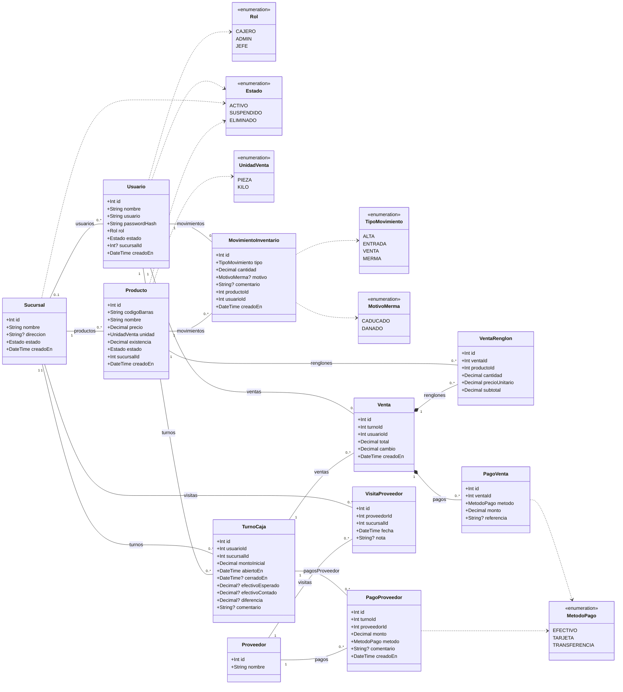
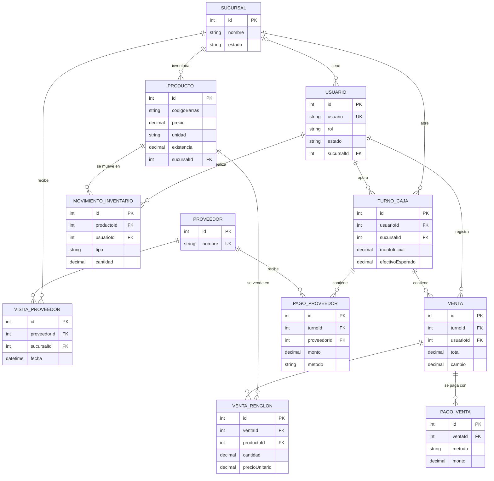

# Diagrama de clases — Abarrotes+

Generado desde `apps/api/prisma/schema.prisma` (fuente de verdad). Si el schema cambia, regenerar este diagrama. Los atributos con `?` son opcionales (pueden ser nulos). `Decimal` se guarda en la base como `Decimal(10,2)` (dinero) o `Decimal(10,3)` (cantidades y existencias a granel).

## Diagrama de clases

Imagen para el documento: [`img/clases.png`](img/clases.png)

Restricciones de unicidad: `Usuario.usuario` es único global; `Proveedor.nombre` es único; `Producto` es único por `(sucursalId, codigoBarras)` (el mismo código puede existir en sucursales distintas).

## Decisiones de diseño

- **Multisucursal desde el inicio:** `Producto`, `TurnoCaja`, `VisitaProveedor` y `Usuario` pertenecen a una `Sucursal`; así HU-14 y HU-16 (Sprint 4) no obligan a migrar datos. `Usuario.sucursalId` es nulo solo para el rol `JEFE`, que opera sobre todas las sucursales.
- **Borrado lógico con `estado`:** `Sucursal`, `Usuario` y `Producto` usan el enum `Estado` (`ACTIVO`, `SUSPENDIDO`, `ELIMINADO`) en lugar de borrar renglones, para conservar el historial de ventas, turnos y movimientos (HU-12 CA3, HU-16).
- **`precioUnitario` copiado en el renglón:** `VentaRenglon` guarda el precio vigente al momento de vender; si después cambia `Producto.precio`, las ventas y cortes pasados no se alteran.
- **`MovimientoInventario` para trazabilidad:** cada alta, entrada, venta o merma registra quién (`usuarioId`), cuándo (`creadoEn`) y cuánto (`cantidad` con signo), base del reporte semanal (HU-13) y de las mermas (HU-10).
- **Pagos separados de la venta:** `PagoVenta` permite el pago mixto (HU-06) y `PagoProveedor` ligado a `TurnoCaja` permite calcular el efectivo esperado del corte (HU-05, HU-09).

## Diagrama ER (simplificado)

Imagen para el documento: [`img/er.png`](img/er.png)

