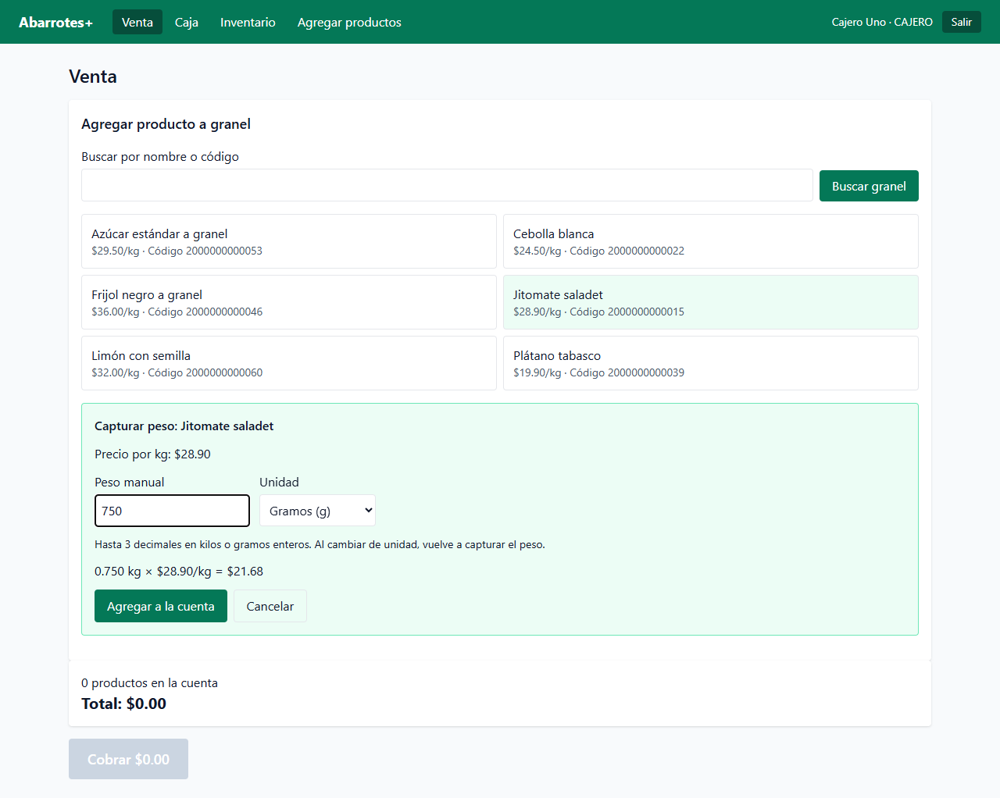
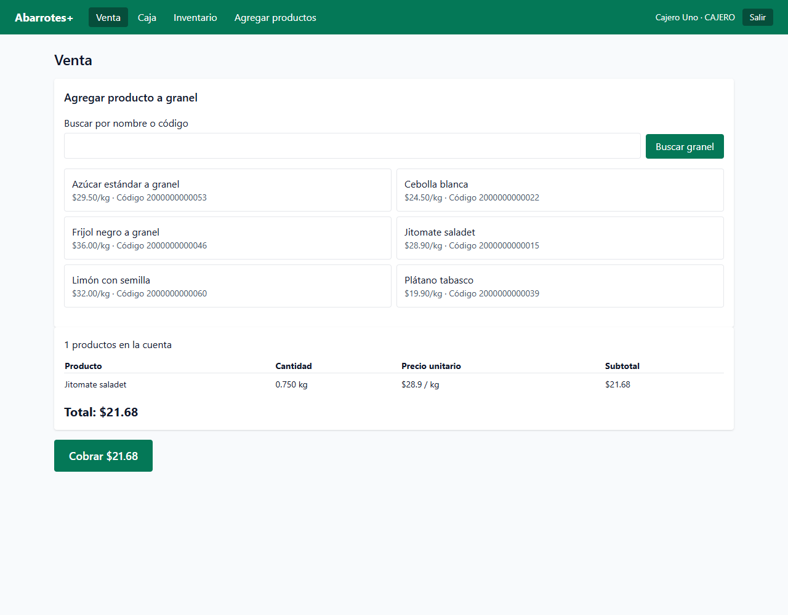
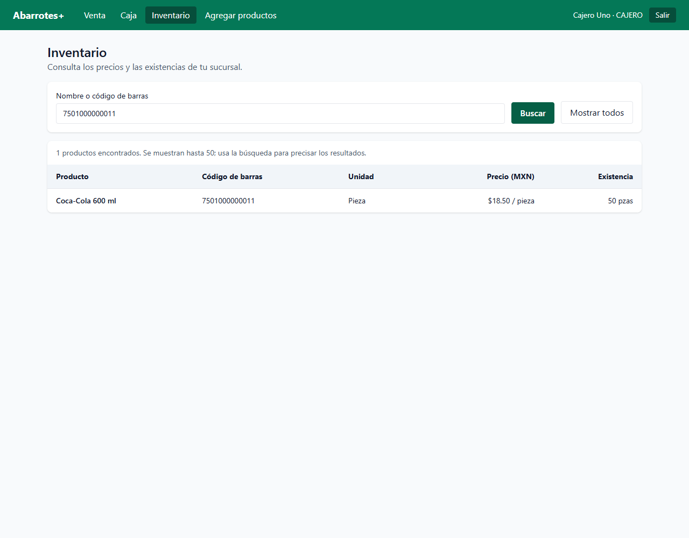

# Entrega local de Miguel · 27 de octubre de 2026

## Implementación

- **HU-03 / T-05 y T-06:** selección de producto por kilo, captura manual kg/g, conversión exacta, validaciones y subtotal half-up. El producto se incorpora al carrito compartido mediante su contrato público; se muestra cantidad, precio por unidad y subtotal.
- **HU-04 / T-13:** inventario de la sucursal autenticada, búsqueda por nombre/código, precio, unidad y existencias; estados de carga, error con reintento y resultados vacíos.
- **D-01:** [diagrama y nueve casos de uso](../../diagramas/casos-de-uso.md). Las capturas de esta carpeta son evidencia de las pantallas implementadas por Miguel; el resto de los prototipos depende de Gonzalo.

## Verificación

- `npm test`: 17 pruebas web y 83 pruebas API.
- `npm run lint`: ESLint y comprobación de tipos en API y web.
- `npm run build`: compilación API y generación web para producción.
- Navegador Edge: login; 750 g de jitomate a $28.90/kg → 0.750 kg y $21.68; incorporación al carrito; rechazo del peso cero; búsqueda de inventario por código; búsqueda sin resultados. Sin errores de JavaScript durante este recorrido.
- Las pruebas de API verifican aislamiento por sucursal, rechazo de piezas fraccionarias y pesos inválidos, recálculo de precios y descuento exacto del inventario.

## Demo

1. Abrir `http://localhost:5173` e iniciar sesión con `cajero1` / `abarrotes123`.
2. En Venta, seleccionar Jitomate saladet, elegir Gramos y escribir `750`. Debe aparecer `0.750 kg × $28.90/kg = $21.68`.
3. Agregar a la cuenta. Repetir con 250 gramos: el carrito conserva un renglón de 1 kg y $28.90.
4. Probar peso `0`, `-1`, texto y `0.0001` kg: ninguno se agrega.
5. Abrir Inventario y buscar `coca`, luego `7501000000011`; consultar precio, existencia y unidad. Buscar algo inexistente para ver el estado vacío.

El flujo de abrir/cerrar caja de Gonzalo sigue pendiente en `develop`; no forma parte de estas HU. El cobro de ventas con turno abierto se comprobó mediante la API en la base de pruebas.

## Archivos que debes poder explicar

- `Granel.tsx`: busca productos de la sucursal, captura el peso y usa `agregarProducto` del carrito existente.
- `calculosGranel.ts`: valida cantidades, convierte gramos a kilos y calcula subtotales con Decimal.
- `granel.test.ts` de web: comprueba conversión, límites, redondeo y compatibilidad con el carrito.
- `InventarioPage.tsx`: presenta la consulta sin modificar productos y descarta respuestas antiguas de búsquedas.
- `productos.test.ts` y `granel.test.ts` de API: prueban permisos por sucursal, cantidades, precios y movimientos reales de inventario.
- `apps/web/vitest.config.ts`: ejecuta las pruebas web sin requerir PostgreSQL; `npm test` también las incluye.

## Entorno preparado en esta computadora

Se instaló PostgreSQL 16 portátil bajo `node_modules/.local-postgres` y se crearon `abarrotes` y `abarrotes_test`. El servidor escucha solo en `127.0.0.1:5432`; `apps/api/.env` contiene la configuración local de ejemplo y está excluido de Git. Los binarios y las bases también quedan excluidos de Git.

Con Node/npm instalados normalmente, el arranque habitual es `npm run dev`. En esta sesión hay además un adaptador local `node_modules/.bin/npm.cmd` para usar el Node incluido en Codex. Desde la raíz se puede ejecutar `& .\node_modules\.bin\npm.cmd run dev` en PowerShell.

Si se reinicia Windows, iniciar primero la base portátil desde la raíz:

```powershell
& .\node_modules\.local-postgres\package\native\bin\pg_ctl.exe -D node_modules/.local-postgres/data-local -l node_modules/.local-postgres/postgres.log -o '-h 127.0.0.1 -p 5432' -w start
```

Para detenerla: el mismo `pg_ctl.exe` con `-D node_modules/.local-postgres/data-local -m fast -w stop`. No borrar `node_modules` antes de respaldar los datos locales que se quieran conservar. También se puede usar el Docker Compose oficial del proyecto después de detener esta instancia.

## Integración pendiente

Los cambios están implementados y validados; se presentan por separado en las ramas `hu-03-granel`, `hu-04-inventario` y `doc-casos-de-uso`, con PR hacia `develop` para revisión de Sosa. Solo Sosa realiza la integración. HU-08 conserva su estado y responsable originales. D-01 debe incorporar los prototipos restantes del equipo para la entrega documental completa.






