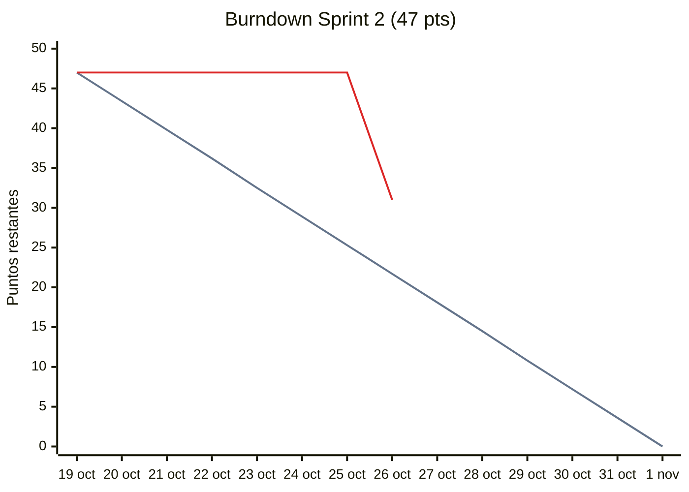
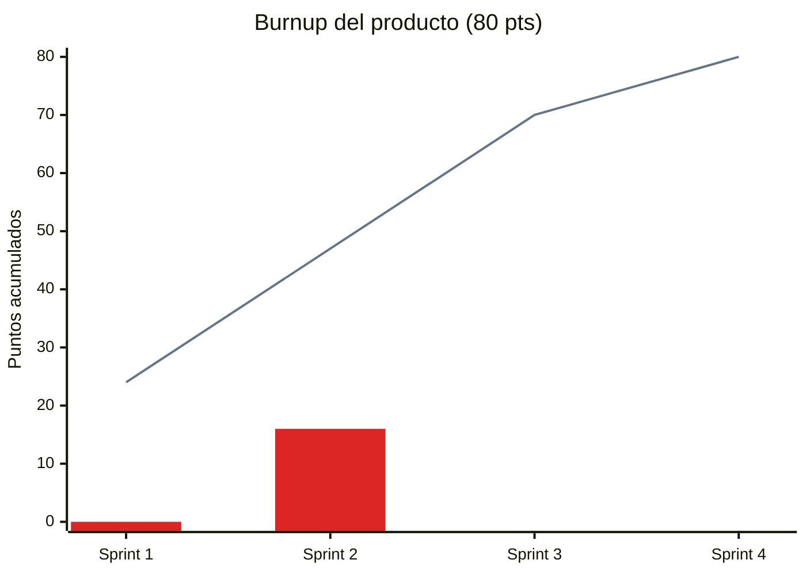

# Burndown / Burnup

## Burndown Sprint 2 (47 pts comprometidos: S1 + S2)

Actualizar cada día con los puntos de HU **completamente hechas** (DoD) al cierre del día. Ideal: lineal de 47 (19 oct) a 0 (1 nov).

| Día | Fecha | Ideal | Real restante | Notas |
|---|---|---|---|---|
| 1 | 19 oct | 47.0 | 47 | |
| 2 | 20 oct | 43.4 | 47 | |
| 3 | 21 oct | 39.8 | 47 | Se arma harness y re-planeación |
| 4 | 22 oct | 36.2 | 47 | |
| 5 | 23 oct | 32.5 | 47 | |
| 6 | 24 oct | 28.9 | 47 | |
| 7 | 25 oct | 25.3 | 47 | |
| 8 | 26 oct | 21.7 | 31 | Se integran HU-01, HU-06 y HU-12 (PRs #1–#3) |
| 9 | 27 oct | 18.1 | | |
| 10 | 28 oct | 14.5 | | |
| 11 | 29 oct | 10.8 | | |
| 12 | 30 oct | 7.2 | | |
| 13 | 31 oct | 3.6 | | |
| 14 | 1 nov | 0.0 | | |

## Burnup del producto (80 pts)

| Sprint | Fin | Plan acumulado | Real acumulado |
|---|---|---|---|
| 1 | 18 oct | 24 | 0 |
| 2 | 1 nov | 47 | |
| 3 | 15 nov | 70 | |
| 4 | 29 nov | 80 | |

Para la gráfica: pedir a la IA `genera la gráfica de burndown/burnup como Mermaid xychart desde docs/scrum/burndown.md` o pasar la tabla a Sheets.

## Gráficas

Actualizar las series "real" al llenar las tablas de arriba. Imágenes exportadas: [`burndown.png`](../diagramas/img/burndown.png), [`burnup.png`](../diagramas/img/burnup.png).

### Burndown Sprint 2 (al 26 oct)

Línea gris: ideal (47 → 0). Línea roja: real restante (días 1–8).

### Burnup del producto (80 pts)

Línea gris: plan acumulado. Barras rojas: real acumulado (Sprint 1 = 0; Sprint 2 parcial al 26 oct = 16).

