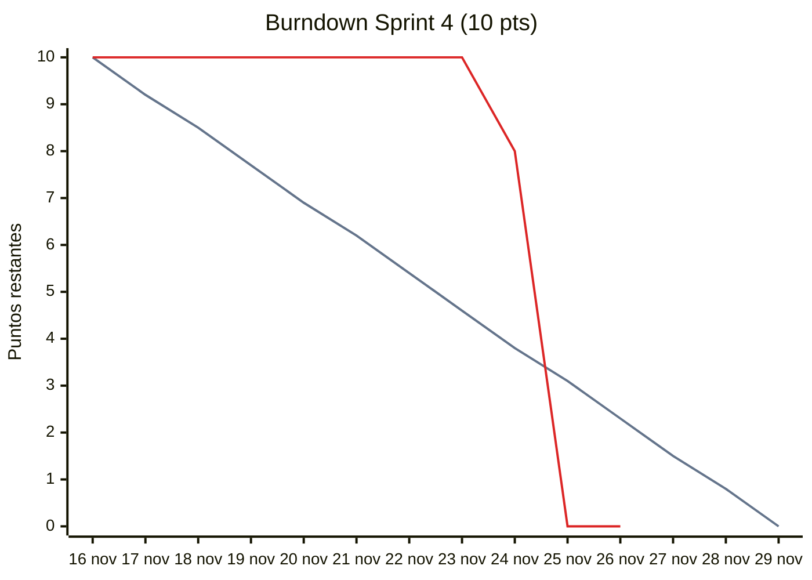
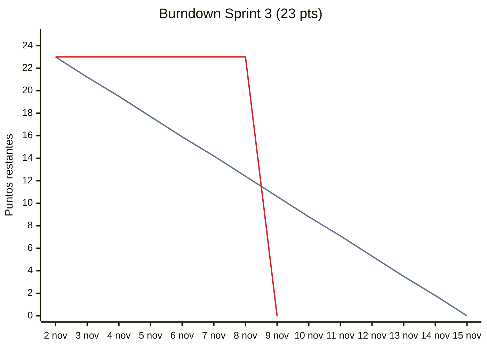
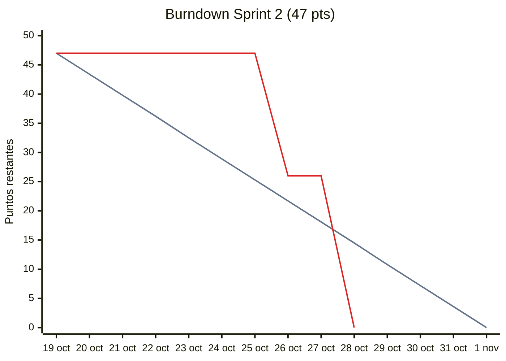
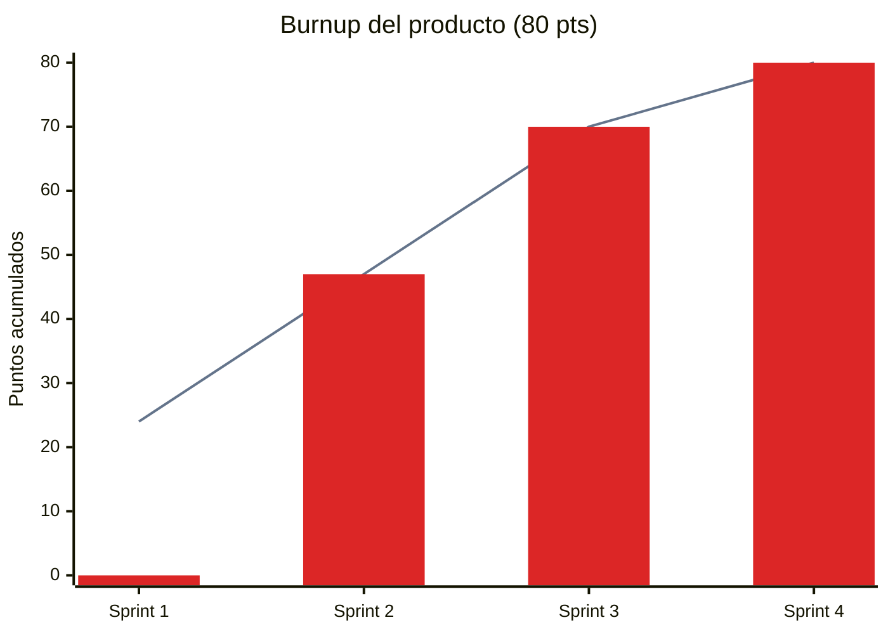

# Burndown / Burnup

## Burndown Sprint 4 (10 pts)

Actualizar cada día con los puntos de HU **completamente hechas** (DoD) al cierre del día. Ideal: lineal de 10 (16 nov) a 0 (29 nov).

| Día | Fecha | Ideal | Real restante | Notas |
|---|---|---|---|---|
| 1 | 16 nov | 10.0 | 10 | |
| 2 | 17 nov | 9.2 | 10 | Cierre del Sprint 3; se redacta el plan del Sprint 4 |
| 3 | 18 nov | 8.5 | 10 | |
| 4 | 19 nov | 7.7 | 10 | |
| 5 | 20 nov | 6.9 | 10 | |
| 6 | 21 nov | 6.2 | 10 | |
| 7 | 22 nov | 5.4 | 10 | |
| 8 | 23 nov | 4.6 | 10 | |
| 9 | 24 nov | 3.8 | 8 | Se publica el plan; se integra HU-14 (#70) |
| 10 | 25 nov | 3.1 | 0 | Se integra HU-16 (#87), de Miguel. Historias completas |
| 11 | 26 nov | 2.3 | 0 | Ajustes T-37, documentación D-06 y D-07; se entrega `v1.0.0`. Sprint cerrado |
| 12 | 27 nov | 1.5 | | |
| 13 | 28 nov | 0.8 | | |
| 14 | 29 nov | 0.0 | | |

## Burndown Sprint 3 (23 pts)

Actualizar cada día con los puntos de HU **completamente hechas** (DoD) al cierre del día. Ideal: lineal de 23 (2 nov) a 0 (15 nov).

| Día | Fecha | Ideal | Real restante | Notas |
|---|---|---|---|---|
| 1 | 2 nov | 23.0 | 23 | |
| 2 | 3 nov | 21.2 | 23 | |
| 3 | 4 nov | 19.5 | 23 | Planeación del sprint |
| 4 | 5 nov | 17.7 | 23 | |
| 5 | 6 nov | 15.9 | 23 | |
| 6 | 7 nov | 14.2 | 23 | |
| 7 | 8 nov | 12.4 | 23 | |
| 8 | 9 nov | 10.6 | 0 | Se integran HU-10 (#50) y HU-13 con PDF (#51) de Miguel, HU-11 (#53) y HU-15 (#54) de Sosa, y HU-07 (#56) de Gonzalo. Sprint completo |
| 9 | 10 nov | 8.8 | | |
| 10 | 11 nov | 7.1 | | |
| 11 | 12 nov | 5.3 | | |
| 12 | 13 nov | 3.5 | | |
| 13 | 14 nov | 1.8 | | |
| 14 | 15 nov | 0.0 | | |

## Burndown Sprint 2 (47 pts comprometidos: S1 + S2)

Actualizar cada día con los puntos de HU **completamente hechas** (DoD) al cierre del día. Ideal: lineal de 47 (19 oct) a 0 (1 nov).

| Día | Fecha | Ideal | Real restante | Notas |
|---|---|---|---|---|
| 1 | 19 oct | 47.0 | 47 | |
| 2 | 20 oct | 43.4 | 47 | |
| 3 | 21 oct | 39.8 | 47 | Se arma harness y re-planeación |
| 4 | 22 oct | 36.2 | 47 | |
| 5 | 23 oct | 32.5 | 47 | |
| 6 | 24 oct | 28.9 | 47 | |
| 7 | 25 oct | 25.3 | 47 | |
| 8 | 26 oct | 21.7 | 26 | Se integran HU-01, HU-06, HU-12 y HU-08 (PRs #1–#3, #7) |
| 9 | 27 oct | 18.1 | 26 | Miguel abre PRs #8–#10 |
| 10 | 28 oct | 14.5 | 0 | Se integran HU-03, HU-04, HU-02 (Miguel), HU-09 y HU-05 (Sosa). Sprint completo |
| 11 | 29 oct | 10.8 | | |
| 12 | 30 oct | 7.2 | | |
| 13 | 31 oct | 3.6 | | |
| 14 | 1 nov | 0.0 | | |

## Burnup del producto (80 pts)

| Sprint | Fin | Plan acumulado | Real acumulado |
|---|---|---|---|
| 1 | 18 oct | 24 | 0 |
| 2 | 1 nov | 47 | 47 |
| 3 | 15 nov | 70 | 70 |
| 4 | 29 nov | 80 | 80 |

Para la gráfica: pedir a la IA `genera la gráfica de burndown/burnup como Mermaid xychart desde docs/scrum/burndown.md` o pasar la tabla a Sheets.

## Gráficas

Actualizar las series "real" al llenar las tablas de arriba. Imágenes exportadas: [`burndown-sprint-4.png`](../diagramas/img/burndown-sprint-4.png), [`burndown-sprint-3.png`](../diagramas/img/burndown-sprint-3.png), [`burndown.png`](../diagramas/img/burndown.png) (Sprint 2), [`burnup.png`](../diagramas/img/burnup.png).

### Burndown Sprint 4 (cerrado el 26 nov)

Línea gris: ideal (10 → 0). Línea roja: real restante (días 1–11).

### Burndown Sprint 3 (cerrado el 9 nov)

Línea gris: ideal (23 → 0). Línea roja: real restante (días 1–8).

### Burndown Sprint 2 (cerrado el 28 oct)

Línea gris: ideal (47 → 0). Línea roja: real restante (días 1–10).

### Burnup del producto (80 pts)

Línea gris: plan acumulado. Barras rojas: real acumulado (Sprint 1 = 0; Sprint 2 = 47, Sprint 3 = 70 y Sprint 4 = 80, completos).

